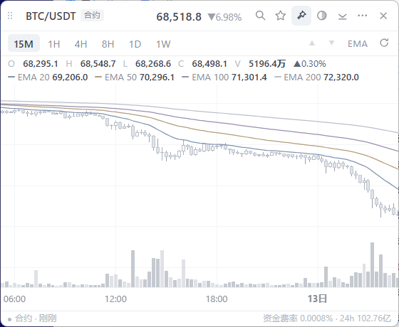
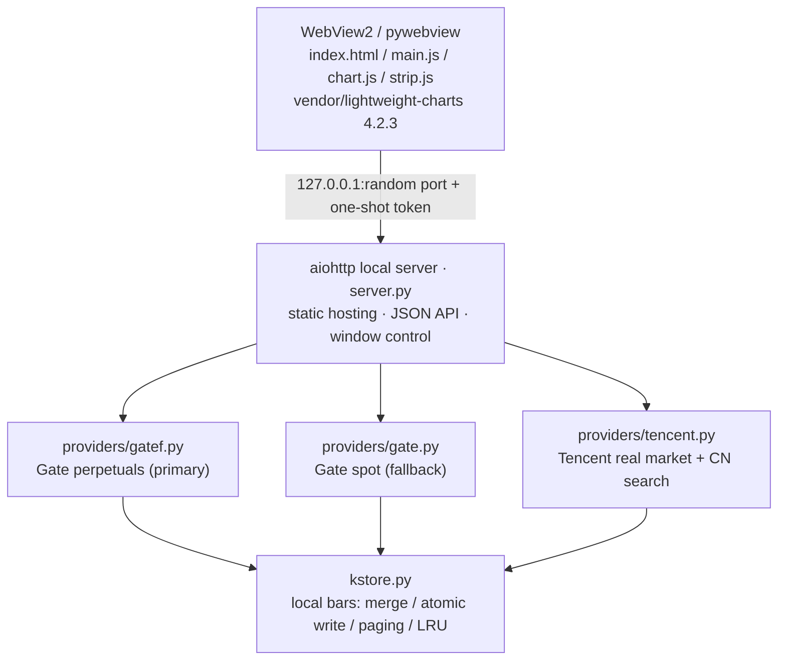

<div align="center">

# MoYuKanPan · 摸鱼看盘

**A 520×400 always-on-top market window for Windows. Light background, four EMAs, no wall of red and green — press `Ctrl+Alt+H` and it disappears.**

[](https://github.com/Tom0xb413/moyu-kanpan/releases)
[](#quick-start)
[](#run-from-source)
[](LICENSE)

[Download](https://github.com/Tom0xb413/moyu-kanpan/releases) · [Quick start](#quick-start) · [Shortcuts](#keyboard-shortcuts) · [中文](README.md)



<sub>Frameless, pin-on-top, light theme, four EMAs plus volume — the status bar shows the data source and freshness.</sub>

</div>

> Quotes come from public Gate.io and Tencent endpoints. They may be delayed, rate-limited, or unavailable. This project is for personal use and learning only — **not investment advice**.

---

## Why

Watching the market at work has three constraints: the screen is shared, so big windows and blinking colours stand out; attention is limited, so staring is costly; and you need to switch away instantly.

MoYuKanPan is built around those constraints: a **small light window** that reads like an ordinary spreadsheet, **four EMAs and volume** (no more), and **a hide hotkey plus a taskbar price strip** so it can leave and come back without ceremony.

No popups, no sounds, no focus stealing. It starts quietly in a corner.

## Features

### Readable at a glance

- Frameless, pin-on-top, resizable, minimum 340×280;
- Light theme; direction is shown with text and greys rather than full-screen red/green;
- Six intervals — 15M / 1H / 4H / 8H / 1D / 1W — switching jumps back to the latest bar and fits the bar count to the window width;
- EMA 20 / 50 / 100 / 200, each toggleable, parameters editable, recalculated immediately;
- Volume subchart, one click to hide;
- Hold and drag the chart to the left to load 400 older bars: the viewport does not jump and all EMAs are recomputed;
- If a symbol or interval switch takes longer than 6 seconds, a progress card appears with a cancel button; the previous chart stays visible, dimmed.

### Easy to hide

- `Ctrl+Alt+H` hides and restores the window; if the combo is taken it falls back to `Ctrl+Alt+Shift+H` or `Ctrl+Alt+B`;
- Collapse to a **price strip**: horizontal 560×32 (5 columns) or vertical 220×150 (5 rows), 5 symbols per page, auto-flip every 6 seconds;
- Closing does not have to quit: ask every time, or preset "quit" / "hide to tray and keep live prices";
- Window opacity cycles through three levels (100% / 90% / 72%), with finer control in the menu;
- Tray icon: left-click toggles, right-click menu, hover shows the latest price of the first symbol;
- When minimised to tray it leaves the taskbar and `Alt+Tab`, while quotes keep refreshing every 4 seconds (15 seconds when hidden).

### Easy to find

- `Ctrl+K` searches **2,700+ symbols**: Gate perpetuals, Gate spot, A-shares, HK and US stocks, indices;
- Chinese names and aliases work: `英伟达`, `苹果`, `纳指`, `黄金`;
- For A-shares just type the 6-digit code (`600519`, `588200`, `000001`) — the `sh` / `sz` / `bj` prefix is added automatically;
- The same stock appears twice — "perp" and "real market" — so you can compare the basis in one click;
- `[` / `]` cycles the recent list, `↑` / `↓` cycles favourites, `F` favourites the current symbol.

### Works when the network does not

- A local bar store writes incrementally per symbol and interval, so startup only fetches the new tail;
- On upstream timeouts the app falls back to local bars and marks the status bar as `local` / `offline`; it reconnects automatically;
- Favourites are warmed in the background for every interval and are never evicted by the LRU;
- Up to 4,000 bars per symbol — the further left you drag, the deeper the local store gets.

## Two shapes

### Full window


Six intervals, four EMAs, volume, last price and change — all in one screen.

### Collapsed price strip


It sits above the taskbar at 90% opacity. Click a symbol to expand the window on it; click the page number to flip manually, otherwise it flips every 6 seconds.

## Quick start

### Download the executable

1. Open [Releases](https://github.com/Tom0xb413/moyu-kanpan/releases) and download the latest `MoYuKanPan.exe`;
2. Double-click it. The first launch takes 2–4 seconds to unpack;
3. If SmartScreen warns, choose "More info → Run anyway" — normal for an unsigned single-file exe.

**Requirements:** Windows 10 / 11 x64 with the WebView2 Runtime (bundled with Windows 11; on Windows 10 install the Microsoft Edge WebView2 Evergreen Runtime if missing).

### Run from source

```bat
git clone https://github.com/Tom0xb413/moyu-kanpan.git
cd moyu-kanpan
python -m venv .venv
.venv\Scripts\activate
python -m pip install -r requirements.txt
python app.py
```

Python 3.10+ (developed and packaged on 3.13). The first run creates `%LOCALAPPDATA%\MoYuKanPan\`.

## Keyboard shortcuts

| Action | Description |
|---|---|
| Drag the title bar | Move the window (the chart area is excluded so panning still works) |
| Drag an edge / corner | Resize, minimum 340×280 |
| `Ctrl+Alt+H` | Hide / restore; falls back to `Ctrl+Alt+Shift+H`, `Ctrl+Alt+B` |
| `Ctrl+K` | Search by name, code, or pinyin alias |
| Click / double-click / `Enter` | Open a search result |
| `[` `]` | Previous / next in the recent list |
| `↑` `↓` | Previous / next favourite |
| `F` | Favourite / unfavourite the current symbol |
| Click the symbol name | Open search |
| Interval buttons | 15M / 1H / 4H / 8H / 1D / 1W, always back to the latest bar |
| `EMA` | Toggle and configure the four EMAs |
| Menu → Volume | Show / hide the volume subchart |
| Top-right ● | Cycle opacity |
| Pin | Toggle always-on-top |
| `r` | Refresh now |
| Hold and drag the chart left | Load 400 older bars |
| Top-right ⌄ / `Ctrl+Alt+M` | Collapse to the price strip; press again to expand |
| Tray icon | Left-click toggles, right-click menu |

## Close behaviour

Clicking ✕, the menu's Quit item, or the window X (`Alt+F4`) asks once by default:

- **Quit**: terminate the process;
- **Keep live prices · minimise to tray**: the main window becomes the price strip, leaves the taskbar and `Alt+Tab`, and the tray icon plus background refresh stay alive.

Tick "don't ask again" to store `exit_ask` / `exit_action` in `prefs.json`; the menu's "Close behaviour…" item can restore the prompt at any time.

Either way, **right-clicking the tray icon and choosing Quit always exits immediately**, so the app can never get stuck running.

## Data sources

| Market | Source | Intervals |
|---|---|---|
| Crypto perpetuals (500+) | Gate.io USDT perpetuals | all |
| US stock perpetuals (400+) | Gate.io stock perpetuals (`NVDA_USDT`, `AAPL_USDT`…) | all |
| Indices / metals / FX / commodities | Gate.io futures (`PAXG`, `DXY`…) | all |
| Long-tail spot-only tokens | Gate.io spot | all |
| A-shares / HK / US / indices (real market) | Tencent quotes | 1D / 1W |

- Perpetual prices are the default: 24/7 and liquid. The status bar labels each chart `perp` / `spot` / `real market`;
- Perpetuals carry funding costs, so a basis versus the official close is expected;
- Real-market feeds have no intraday bars — that is a limitation of the source, not a bug;
- Money-market funds (NAV only, no candles) are filtered out of search results.

## How it works



Design notes:

- **Local first.** Every request checks the local store within its TTL and only then hits the network. If the network fails, stale bars stay on screen and the status bar says so.
- **Fallback chain.** `gf` (perpetual) → `gate` (spot with the same code); real-market symbols use `tx` and never mix with the perp feed.
- **Locked down.** The HTTP server binds `127.0.0.1` on a random port, and `/api/*` requires a token generated at launch, so other local processes cannot drive the window.
- **No account, no telemetry.** Nothing to sign in to, nothing collected. Quote requests go straight to Gate and Tencent.
- **System proxy is bypassed.** The app clears `HTTP_PROXY` and disables `trust_env` on purpose; a corporate proxy typically breaks these endpoints. Set `MOKU_DEBUG=1` for verbose logs.

## Project layout

```
moyu-kanpan/
├─ app.py                    entry point: window, hotkey, single instance, local server
├─ backend/
│  ├─ providers/
│  │  ├─ gatef.py            Gate perpetuals (primary)
│  │  ├─ gate.py             Gate spot (fallback)
│  │  └─ tencent.py          Tencent real market + Chinese search
│  ├─ server.py              aiohttp routes, token auth, static hosting
│  ├─ symbols.py             symbol parsing, capability matrix, fallback, paging
│  ├─ kstore.py              local bar store (merge, atomic write, LRU)
│  ├─ search.py              2,700+ symbol index, aliases, market groups
│  ├─ ticker.py              background quote snapshot (tray / strip)
│  ├─ tray.py                system tray
│  ├─ win32.py               frameless drag / resize / pin / rounded corners / alpha
│  ├─ hotkey.py              global hotkeys on a dedicated message loop
│  ├─ prefs.py               atomic prefs.json read/write
│  ├─ net.py                 concurrency gate, per-host pacing, retries, stats
│  └─ config.py              paths, intervals, TTLs, limits, logging
├─ frontend/
│  ├─ index.html
│  ├─ css/app.css
│  └─ js/                    main.js / chart.js / strip.js / search.js / api.js / ema.js / format.js
├─ vendor/                   lightweight-charts 4.2.3 (offline)
├─ assets/app.ico
├─ build/app.spec            PyInstaller one-file build
├─ tests/
├─ requirements.txt
└─ README.md / README.en.md
```

## Local data

Everything lives under `%LOCALAPPDATA%\MoYuKanPan\`:

| Path | Contents |
|---|---|
| `prefs.json` | Window geometry, interval, recents, favourites, EMA toggles, strip symbols, close behaviour |
| `bars\` | One file per symbol + interval; favourites are never pruned, max 4,000 bars per file |
| `app.log` | Rotating log (2 files, 1.5 MB each) |
| `cache\` | Legacy snapshot directory, kept for compatibility |

Delete the whole directory to reset the app.

## Build

```bat
python -m pip install -r requirements.txt
pyinstaller build/app.spec
```

The output is `dist\MoYuKanPan.exe` (single file, roughly 21 MB). The spec already excludes tkinter, Qt, numpy and other unused dependencies.

## Tests

```bat
python tests\test_kstore.py       :: local store: merge / dedupe / truncation / LRU, offline
python tests\test_cn_source.py    :: Tencent real market, 27 live-network checks
python tests\probe_zoom.py        :: headless Edge probe for viewport after interval switches (needs playwright)
```

`test_cn_source.py` hits the live Tencent endpoints to catch "search works but the chart is empty" regressions; `probe_zoom.py` is an optional developer probe.

## FAQ

**Double-click does nothing.**
Check `%LOCALAPPDATA%\MoYuKanPan\app.log`. The usual cause is antivirus blocking the one-file exe from unpacking; whitelist the `dist` folder.

**The chart stopped updating.**
Public endpoints are rate-limited occasionally. The app falls back to local bars and marks the status bar `local` / `offline`; it resumes automatically.

**Switching symbols or intervals hangs.**
A progress card appears with the current stage, elapsed seconds and Cancel. After 6 seconds it reports that a fallback source is being tried. The old chart stays dimmed and returns instantly on cancel.

**A-share search finds the name but the chart says "no data source".**
Fixed in v1.3.1: Tencent's smartbox puts the market in a separate field, and early builds dropped that prefix. Legacy bare codes are now normalised automatically.

**Bars are squeezed to the right after switching intervals.**
Fixed in v1.3.2: interval switches always return to the latest bar, range callbacks during `setData` are suppressed, and the default viewport is sized from the window width.

**Corporate proxy?**
The app clears `HTTP_PROXY` and disables `trust_env` by default. If you must use a proxy, change `trust_env` in `backend/net.py` and the endpoints in `config.py`.

## Limitations

- Windows only (Win32 window APIs plus WebView2);
- Real-market feeds have no intraday bars; the app switches to 1D and greys out minute intervals;
- Newly listed US stock perpetuals have short histories, so EMA 100 / 200 may show `—`;
- Light theme only — no dark mode yet;
- Upstream endpoints have no SLA; extreme markets can delay or drop data.

## Contributing

Issues and pull requests are welcome. If you touch data sources or symbol rules, run `python tests\test_cn_source.py` first; if you change viewport logic, include the output of `tests\probe_zoom.py`. Please make sure no personal data from `%LOCALAPPDATA%` or any token ends up in a commit.

## License

[MIT](LICENSE)

## Disclaimer

This project is for personal learning and technical exchange. It provides no investment advice, no market-data guarantee, and no trading service. Market data belongs to its respective providers. Any decision or consequence arising from the use of this tool is the user's own.
