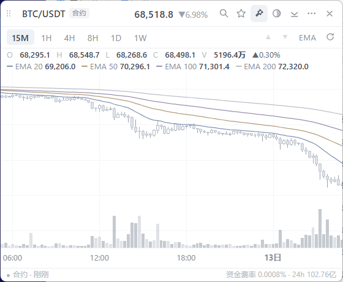
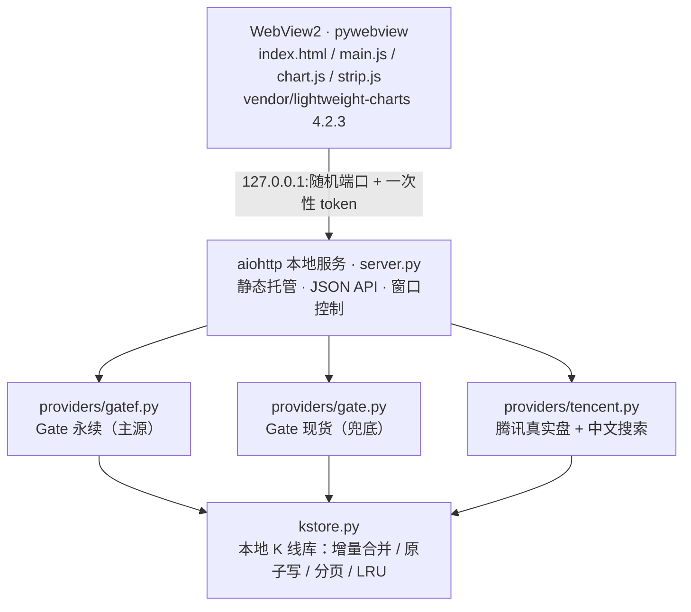

<div align="center">

# 摸鱼看盘 · MoYuKanPan

**一个 520×400 的 Windows 桌面行情小窗。白底、四条 EMA、没有满屏红绿，按一下 `Ctrl+Alt+H` 就从屏幕上消失。**

[](https://github.com/Tom0xb413/moyu-kanpan/releases)
[](#快速开始)
[](#从源码运行)
[](LICENSE)

[下载运行包](https://github.com/Tom0xb413/moyu-kanpan/releases) · [快速开始](#快速开始) · [快捷键](#快捷键) · [English](README.en.md)



<sub>完整窗口：无边框、可置顶、白底灰烛，四条 EMA + 成交量，状态栏显示数据源与新鲜度</sub>

</div>

> 行情来自 Gate.io 与腾讯的公开接口，可能延迟、限频或中断。本项目仅供个人学习与自用，**不构成任何投资建议**。

---

## 这个工具解决什么问题

在办公室看盘有三个现实约束：屏幕是共享的，大窗口和红绿闪烁太显眼；注意力是有限的，盯太久会影响工作；手要随时能切走，所以必须能一键消失、随时回来。

摸鱼看盘把这三件事拆成三个设计：**浅色小窗**（远看像一张普通表格）、**四条 EMA + 成交量**（够用就好）、**隐身热键 + 任务栏价位条**（随时退场、余光可见）。

它不弹窗、不播报、不抢焦点，启动后安静地待在角落。

## 特性

### 看得清

- 无边框、可置顶、可缩放，最小 340×280；
- 白底浅色主题，涨跌用文字与灰阶表达，不做满屏红绿；
- 15M / 1H / 4H / 8H / 1D / 1W 六个周期，切换后自动回到最新 K 线，并按窗口宽度适配显示根数；
- EMA 20 / 50 / 100 / 200 四条均线，可单独开关、可改参数，改完即时重算；
- 成交量副图，可一键隐藏；
- 按住图表向左拖，自动加载更早 400 根 K 线：视口不跳动，四条 EMA 同步重算；
- 切标的 / 切周期超过 6 秒会显示进度卡，可随时取消，旧 K 线淡化保留。

### 藏得住

- `Ctrl+Alt+H` 一键隐身 / 唤回；被其他软件占用时自动改用 `Ctrl+Alt+Shift+H` 或 `Ctrl+Alt+B`；
- 右上角一键收起为**价位条**：横向 560×32（5 列）或竖向 220×150（5 行），每页 5 个、6 秒自动翻页；
- 点关闭不直接退出：可每次问询，也可预设为「直接退出」或「隐藏主窗、只留托盘与实时价位」；
- 整窗透明度三档循环（100% / 90% / 72%），菜单里可以细调；
- 系统托盘常驻：左键显隐，右键菜单，悬停显示首个标的最新价；
- 最小化到托盘时从任务栏与 `Alt+Tab` 移除，后台仍按 4 秒（隐藏时 15 秒）刷新报价。

### 找得到

- `Ctrl+K` 搜索 **2700+ 标的**：Gate 永续、Gate 现货、A股 / 港股 / 美股 / 指数；
- 支持中文与别名：`英伟达`、`苹果`、`纳指`、`黄金`；
- A股直接输 6 位代码（`600519`、`588200`、`000001`），自动补 `sh` / `sz` / `bj` 市场前缀；
- 同一只股票会同时给出「合约」与「真实盘」两条，点一下即可对照基差；
- `[` `]` 在最近列表切换，`↑` `↓` 在收藏列表切换，`F` 收藏当前标的。

### 断网也能看

- 本地 K 线库按「标的 + 周期」增量落盘：启动只补新增的尾巴，不重复下载；
- 上游超时自动回落本地，状态栏标注 `本地` / `离线`；网络恢复后自动续上；
- 收藏的标的后台补齐全部周期，且永不参与 LRU 清理；
- 单个标的最多保留 4000 根 K 线，向左拖得越深，本地库越完整。

## 两种形态

### 完整窗口


适合需要看结构的时候：六个周期、四条均线、成交量、最新价与涨跌幅都在一屏内。

### 收起后的价位条


收起后贴着任务栏右下角，整窗不透明度 90%。点某个标的会展开窗口并切到它；点页码手动翻页，不点时 6 秒自动翻。

## 快速开始

### 方式一：下载运行包

1. 打开 [Releases](https://github.com/Tom0xb413/moyu-kanpan/releases)，下载最新的 `MoYuKanPan.exe`；
2. 双击运行，首次启动会解包 2–4 秒；
3. 若 SmartScreen 提示「已保护你的电脑」，点「更多信息 → 仍要运行」——未签名单文件 exe 的正常提示。

**环境要求**：Windows 10 / 11 x64，系统需要 WebView2 Runtime（Windows 11 自带；Windows 10 若缺失，安装一次 Microsoft Edge WebView2 Evergreen Runtime 即可）。

### 从源码运行

```bat
git clone https://github.com/Tom0xb413/moyu-kanpan.git
cd moyu-kanpan
python -m venv .venv
.venv\Scripts\activate
python -m pip install -r requirements.txt
python app.py
```

Python 3.10+（开发与打包使用 3.13）。首次运行会在 `%LOCALAPPDATA%\MoYuKanPan\` 建立本地库。

## 快捷键

| 操作 | 说明 |
|---|---|
| 拖动顶栏 | 移动窗口（图表区域不响应拖动，避免影响平移） |
| 拖四边 / 四角 | 缩放窗口，最小 340×280 |
| `Ctrl+Alt+H` | 隐身 / 唤回；被占用时自动换 `Ctrl+Alt+Shift+H`、`Ctrl+Alt+B` |
| `Ctrl+K` | 搜索标的，支持中文、代码、拼音别名 |
| 单击 / 双击 / `Enter` | 打开搜索结果 |
| `[` `]` | 在「最近」列表前后切换 |
| `↑` `↓` | 在「收藏」列表前后切换 |
| `F` | 收藏 / 取消收藏当前标的 |
| 点品种名 | 打开搜索 |
| 周期按钮 | 15M / 1H / 4H / 8H / 1D / 1W，切换后自动回到最新 |
| `EMA` | 四条均线开关与参数 |
| 菜单 → 成交量 | 显示 / 隐藏成交量副图 |
| 右上 ● | 透明度三档循环 |
| 图钉 | 窗口置顶开关 |
| `r` | 立即刷新 |
| 按住图表向左拖 | 加载更早 400 根 K 线 |
| 右上 ⌄ / `Ctrl+Alt+M` | 收起为价位条；再按一次展开 |
| 托盘图标 | 左键显隐，右键「收起为滚动条 / 退出」 |

## 关闭行为

点右上 ✕、菜单「退出」或系统窗口 X（含 `Alt+F4`）时，默认问一次：

- **直接退出**：结束进程；
- **保留实时价位 · 最小化到托盘**：主窗收成价位条，从任务栏与 `Alt+Tab` 移除，托盘图标常驻，后台报价继续刷新。

勾选「不再询问」后写入 `prefs.json` 的 `exit_ask` / `exit_action`；菜单「关闭行为…」可随时改回每次询问。

无论怎么设置，**托盘右键「退出摸鱼看盘」始终是直接退出**，保证随时能真正关掉。

## 数据源

| 市场 | 数据源 | 可用周期 |
|---|---|---|
| 加密永续（500+） | Gate.io USDT 永续 | 全周期 |
| 美股合约（400+） | Gate.io 股票永续（`NVDA_USDT`、`AAPL_USDT`…） | 全周期 |
| 指数 / 金属 / 外汇 / 商品 | Gate.io 合约（`PAXG`、`DXY`…） | 全周期 |
| 长尾小币（只有现货） | Gate.io 现货 | 全周期 |
| A股 / 港股 / 美股 / 指数（真实盘） | 腾讯行情 | 1D / 1W |

- 默认看**合约**价：24 小时连续、成交量大，状态栏会标注「合约 / 现货 / 真实盘」；
- 合约价含资金费率影响，与个股收盘价存在基差，属正常现象；
- 真实盘（A股 / 港股 / 美股官方）没有分钟线，这是数据源本身的限制，不是 bug；
- 场外基金只有净值、没有 K 线，已从搜索结果中过滤。

## 工作原理



几个关键设计：

- **本地优先**：每次请求先看 TTL 内的本地库，过期才联网；联网失败保留旧数据并在状态栏标注，不白屏。
- **降级链**：`gf`（永续）→ `gate`（同代码现货）；真实盘走 `tx`，与合约互不干扰。
- **鉴权**：本地服务只监听 `127.0.0.1`，端口随机，`/api/*` 需要启动时生成的一次性 token，避免同机其他程序随便调用。
- **无账号、无遥测**：不需要登录，不收集任何数据；行情请求直接发往 Gate 与腾讯。
- **不走系统代理**：程序启动时会清理 `HTTP_PROXY` 等变量并禁用 `trust_env`，避免公司代理劫持行情请求（实测走代理会超时）。需要看请求日志时用 `MOKU_DEBUG=1`。

## 项目结构

```
moyu-kanpan/
├─ app.py                    入口：窗口、热键、单实例、本地服务、关闭行为
├─ backend/
│  ├─ providers/
│  │  ├─ gatef.py            Gate 永续（主源）
│  │  ├─ gate.py             Gate 现货（长尾兜底）
│  │  └─ tencent.py          腾讯真实盘 + 中文搜索
│  ├─ server.py              aiohttp 路由、token 鉴权、静态托管
│  ├─ symbols.py             symbol 解析、能力矩阵、降级链、历史分页
│  ├─ kstore.py              本地 K 线库（增量合并、原子写、LRU）
│  ├─ search.py              2700+ 标的索引、别名、市场分组
│  ├─ ticker.py              后台报价快照（托盘 / 价位条共用）
│  ├─ tray.py                系统托盘
│  ├─ win32.py               无边框拖动 / 缩放 / 置顶 / 圆角 / 整窗透明度
│  ├─ hotkey.py              全局热键（独立消息循环）
│  ├─ prefs.py               prefs.json 原子读写
│  ├─ net.py                 并发闸门、按 host 限速、重试退避、统计
│  └─ config.py              路径、周期、TTL、限速、日志
├─ frontend/
│  ├─ index.html
│  ├─ css/app.css
│  └─ js/                    main.js / chart.js / strip.js / search.js / api.js / ema.js / format.js
├─ vendor/                   lightweight-charts 4.2.3（离线可用）
├─ assets/app.ico
├─ build/app.spec            PyInstaller 单文件打包配置
├─ tests/
├─ requirements.txt
└─ README.md / README.en.md
```

## 本地数据

都在 `%LOCALAPPDATA%\MoYuKanPan\`：

| 路径 | 内容 |
|---|---|
| `prefs.json` | 窗口位置与尺寸、周期、近期、收藏、EMA 开关、价位条标的、关闭行为 |
| `bars\` | 按「标的 + 周期」拆分的 K 线文件；收藏标的不参与清理，单文件最多 4000 根 |
| `app.log` | 运行日志（滚动保留 2 份，单份 1.5 MB） |
| `cache\` | 旧版快照目录，仅作兼容保留 |

删除整个目录即可恢复出厂状态。

## 从源码构建

```bat
python -m pip install -r requirements.txt
pyinstaller build/app.spec
```

产物为 `dist\MoYuKanPan.exe`（单文件，约 21 MB）。打包配置已排除 tkinter、Qt、numpy 等无关依赖。

## 测试

```bat
python tests\test_kstore.py       :: 本地库：合并 / 去重 / 截断 / LRU，纯离线
python tests\test_cn_source.py    :: 腾讯真实盘全链路，27 项真实网络回归
python tests\probe_zoom.py        :: 无头 Edge 检查周期切换后的可视区间（需 playwright）
```

`test_cn_source.py` 会真实访问腾讯行情，用于防止「搜得到名字、点进去无数据」这类回归；`probe_zoom.py` 是可选的开发探针。

## 常见问题

**双击没反应？**
看 `%LOCALAPPDATA%\MoYuKanPan\app.log`。常见原因是杀软拦截了单文件 exe 的解包，把 `dist` 目录加入白名单即可。

**数据不动了？**
上游是公开接口，偶尔限频。窗口会自动退到本地 K 线并在状态栏提示「本地 / 离线」，网络恢复后自动续上。

**切标的 / 切周期卡住？**
图表区会出现进度卡，显示当前阶段、已用秒数和「取消」；超过 6 秒会提示正在尝试备用源。旧 K 线会变淡保留，取消后立即恢复。

**A股搜得到名字、点进去却显示「无可用数据源」？**
v1.3.1 已修复：腾讯 smartbox 把市场放在独立字段，早期版本拼 symbol 时丢了前缀。历史收藏里的裸码现在会自动归一化。

**切换周期后 K 线挤在右侧 / 太密？**
v1.3.2 已修复：切换周期强制回到最新，`setData` 期间的区间回调被抑制，默认视口按窗口宽度计算根数。

**代理环境？**
程序会主动清掉 `HTTP_PROXY` 等环境变量并禁用 `trust_env`。如果必须走代理，可自行修改 `backend/net.py` 的 `trust_env` 与 `config.py` 的请求地址。

**想换默认窗口大小？**
菜单调整窗口后会自动记住位置与尺寸。

## 已知边界

- 仅支持 Windows（依赖 Win32 窗口 API 与 WebView2）；
- 真实盘没有分钟线，点进去会自动切到 1D，分钟周期按钮置灰；
- 新上市的美股合约历史很短，EMA 100 / 200 可能显示 `—`；
- 界面为浅色单一主题，暂未做深色模式；
- 上游接口没有 SLA，极端行情下可能延迟或缺失。

## 参与贡献

欢迎提 Issue 和 PR。改动数据源或 symbol 规则时，请先跑 `python tests\test_cn_source.py`；改动图表视口逻辑时，请附上 `tests\probe_zoom.py` 的结果。提交前请确保没有把 `%LOCALAPPDATA%` 下的个人数据或任何 token 带进仓库。

## License

[MIT](LICENSE)

## 免责声明

本项目仅用于个人学习与技术交流，不提供任何形式的投资建议、行情担保或交易服务。行情数据版权归各自数据源所有。使用本工具产生的任何决策与后果，由使用者自行承担。
